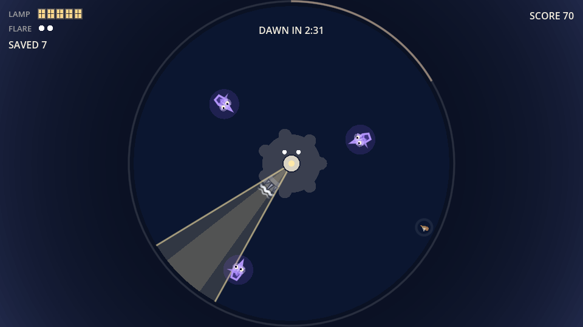
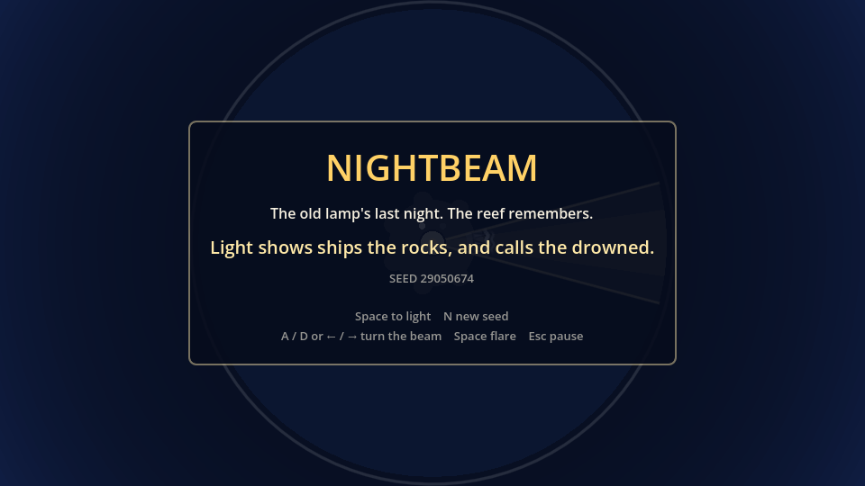
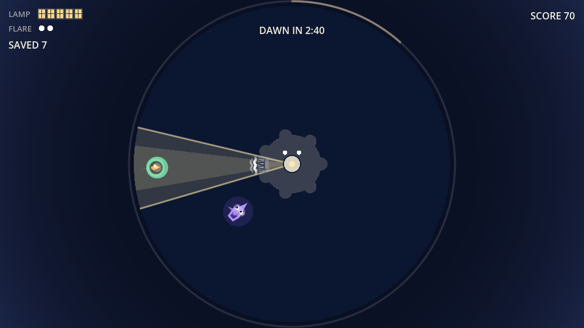
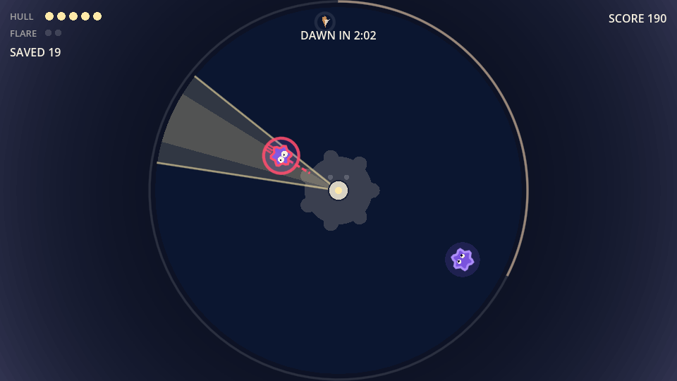
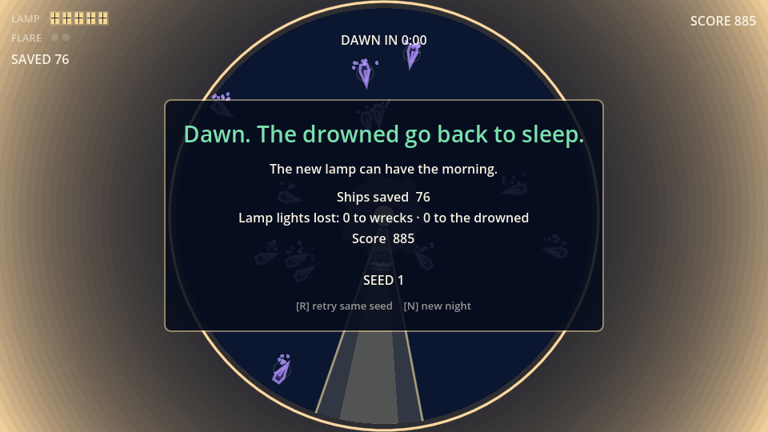
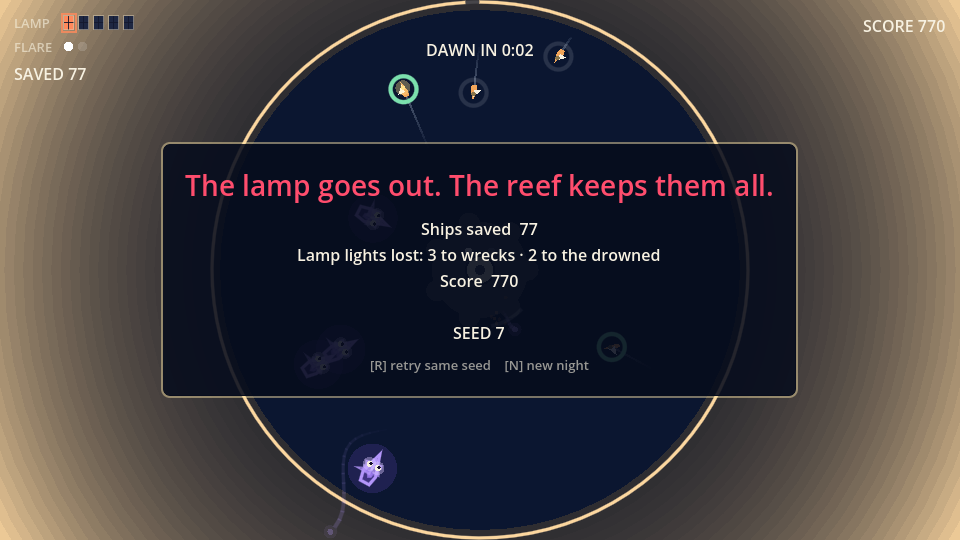

# NIGHTBEAM

**The old lamp's last night. The reef remembers.** You are the keeper of a lighthouse on a reef. Turn one narrow beam through a three-minute night: light shows the ships the rocks so they turn back to sea, but it also calls the drowned, ghost ships of every wreck this reef ever caused, and they come straight for your lamp.



## How to play

| Key | Action |
|---|---|
| A / D or ← / → | Turn the beam |
| Space | Start the night; fire a flare (clears nearby ghosts) |
| Esc | Pause |
| R / N | Retry the same night / a new night |

- Hold the beam on a ship until its ring fills. Its masthead lamp blinks back and it turns away from the rocks.
- Don't light the purple ghost ships. Lit, they lunge for the lighthouse, and each one that reaches it puts out a window of your lamp. Left dark, they stop short, watch the beam, and fade.
- Keep at least one lamp window lit until dawn.

| | | |
|---|---|---|
|  |  |  |
|  |  | |

## Run it

Open the folder with [Godot 4.6](https://godotengine.org/) and press Play, or from a terminal:

```bash
godot --path .
```

Start a specific night with `godot --path . -- --seed=42`.

### Tests and bots

The rules live in a pure, seeded simulation (`Scripts/Sim/`) stepped at a fixed 60 Hz, separate from the view, so the same seed always plays out the same way.

```bash
godot --headless --path . -s res://Tests/TestRunner.gd
godot --headless --path . -s res://Tests/BotRunner.gd -- --seeds=1-100 --out=Tests/Results/bots.csv
```

`TestRunner` checks the rules, the invariants and determinism over 100 seeds with three bot skills. `BotRunner` writes a CSV of how idle, greedy and careful bots do. A careful bot survives about 1.5× as long as a greedy one and reaches dawn in about 70% of nights.

`.playtest/` holds the [playtest-lab](https://github.com/mhwangbo/playtest-lab) adapter: bot players over the Godot bridge, a regression baseline (`lab.js check`), and a windowed persona mode for AI playtesters. Point it at your Godot binary with `GODOT_BIN` or a `.playtest/local.json` containing `{ "godot": "<path>" }`.

## How it was made

NIGHTBEAM was built by [ai-game-studio](https://github.com/mhwangbo/ai-game-studio), a team of Claude Code agents (designer, tech lead, gameplay, UI and engine programmers, writer, QA) run by a producer agent, with a human deciding at every gate. It took 3 milestones: a playable M1, "Readable Shades" after the first playtest showed nobody understood the ghosts, and "Story & framing" after the second. Every balance change passed a bot regression gate before it landed. Visuals are drawn in code and sounds are generated; there are no external assets.

[`design/`](design/) has the pitch, the game design document, the technical design, the framing options and the decision log.

## License

[MIT](LICENSE)
